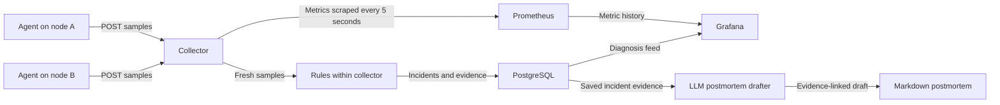

# FleetDoctor PRD

Oct 10, 2026 · @Milo

Revised Oct 11, 2026 · Version 1 · Finalized

FleetDoctor is a Linux fleet health monitor that watches a small fleet, detects resource failures, and produces rule-based diagnoses with supporting evidence and investigation steps. Diagnoses identify the affected node and resource; a specific culprit is named when the collected evidence supports it.

## Goal

Build and demonstrate production-engineering skills: Linux internals, troubleshooting, and reliability. Success looks like:

- All 8 chaos scenarios pass 5 measured runs each, with the correct node, an evidence-supported resource diagnosis, and useful investigation steps in every run.
- Median trigger-to-diagnosis latency is under 30 seconds for each scenario; injection-to-diagnosis time is also reported.
- A one-hour healthy baseline across both monitored nodes produces zero false incidents.
- Each scenario has a postmortem and runbook in the repo.
- An LLM postmortem drafter produces an evidence-linked draft from a measured incident for each of the eight scenarios.
- DistributedKVStore runs as a monitored workload, with a documented read/write flow traced using `strace` and `tcpdump` and correlated with FleetDoctor metrics.
- You can explain every metric and rule in an interview without notes.

## Non-goals and users

Out of scope: custom UI beyond Grafana, ML or LLMs in the diagnosis path, auto-remediation, multi-region, and custom user accounts or RBAC. Access to the cloud lab is restricted through AWS network controls and SSH.

The primary user is an on-call engineer who needs to know what is wrong, on which node, and why. The real audience is interviewers reading the repo.

## Architecture

Agents send samples to the central collector. The collector evaluates samples through the rules engine and exposes the latest node metrics for Prometheus to scrape. Prometheus stores metric history; PostgreSQL stores incident records and their evidence. Grafana reads both stores.

1. **Agent** (Python, one per monitored node): reads Linux metrics and kernel events, runs bounded network and DNS probes, computes rates, and POSTs JSON to the collector every 5 seconds.
2. **Collector** (FastAPI): ingests agent samples, maintains the latest metrics for `/metrics`, and passes accepted samples to the rules engine. Its query API reads metric history from Prometheus and incident records from PostgreSQL.
3. **Rules engine:** runs within the collector service and applies the USE method (utilization, saturation, errors). Sustained metric conditions and confirmed kernel events produce incidents with evidence.
4. **Storage and dashboards:** Prometheus stores numeric metric history. PostgreSQL stores diagnoses, supporting evidence, timestamps, and incident resolution history. Grafana queries Prometheus for per-node and fleet graphs and PostgreSQL for the diagnosis feed. All central services run through Docker Compose on the monitoring VM.
5. **Chaos harness:** one script per failure scenario plus an orchestrator that measures diagnosis and recovery through the API. The harness supplies fault ground truth to reports; the rules engine receives ordinary telemetry.
6. **Deploy:** AWS EC2 Linux VM lab with one monitoring server and two monitored nodes in the same VPC and availability zone. Docker Compose runs the central services on the monitoring server; agents run directly on the monitored hosts. Chaos experiments target the monitored nodes.
7. **Postmortem drafter:** a command reads a saved incident and its measurement/cleanup record, invokes an LLM, and writes a Markdown draft with evidence references. Rules determine diagnoses; draft generation runs after the incident is recorded.
8. **Workload integration:** run the existing DistributedKVStore in the lab, monitor its processes and resources, and capture a read/write workload with `strace` and `tcpdump` for a syscall/network investigation write-up.

## Deployment and cost constraints

- AWS is the chosen cloud provider. Existing credits are available, estimated by the owner at roughly $100 or more; preserve most of that balance.
- Agreed spending target: at most $20 of AWS usage for the complete core build and demonstration, measured before credits. Include DistributedKVStore hosting and any AWS-hosted model inference charges. This is a planning target rather than an automatic billing cap.
- Run the lab during active development, experiments, and demos, then stop the instances. EBS storage continues to incur charges while retained; teardown must preserve required results and documentation.
- Agents send metrics over private VPC addresses. Restrict SSH access to the owner's address and access central service interfaces through SSH tunnels.
- Instance sizes and the region will be selected with a current cost estimate before provisioning. Account for compute, EBS, public IPv4 addresses, and any burstable CPU surplus charges.
- Use a Linux image with cgroup v2. Initial capacity planning assumes about 4 GB RAM for the monitoring server and 2 GB per monitored node; verify the selected sizes against the cost target before provisioning.
- Provide documented start, stop, export, and teardown procedures. Report project usage before credits so credit consumption is visible.
- Select model access and estimate generation costs before using the postmortem drafter. Record the model backend and any costs in the project cost report; prefer available credited access that fits the budget.

## Functional requirements

**Agent and collection**

- Collect CPU utilization from `/proc/stat` deltas, runnable-process count, logical CPU count, load average, iowait, and steal time. Keep utilization, runnable demand, and load average distinct in the evidence.
- Collect host memory and swap from `/proc/meminfo`, page faults and swap activity from `/proc/vmstat`, and configured workload cgroup memory usage, limits, and local OOM-event counters from `/sys/fs/cgroup`.
- Collect block and inode usage for configured filesystems using `statvfs`, including the dedicated chaos filesystem. Collect completed read/write counts, read/write timing, I/O in progress, and weighted I/O time from `/proc/diskstats` for configured backing devices. Derive interval throughput, average request completion latency, and average outstanding I/O; identify the device layer used rather than summing parent and child devices. Collect host/workload I/O pressure where available and per-process I/O counters for configured workloads to support attribution.
- Collect TCP state counts, retransmits, interface errors, and drops from `/proc/net` and `/sys/class/net`. Host-wide TCP counters are evidence about the node, not proof of a particular interface fault.
- Collect CPU, resident memory, FD count, and the process's actual soft FD limit for configured workloads and a bounded top-process set. Start with top 10 processes by CPU and memory plus configured workloads. Identify a process by PID and start time so PID reuse does not merge unrelated evidence. A small configured FD-leak workload must be included even when it is outside the top-process set.
- Read kernel logs incrementally for OOM-kill and I/O-error evidence. Report missing log permissions as a coverage limitation. Cgroup counters provide OOM evidence when victim details are unavailable in logs.
- Run direct-IP ICMP probes to the monitoring VM, recording packet loss and round-trip latency. Permit this traffic in the lab network. Use three packets per sample with a bounded total timeout. Keep probe traffic separate from agent ingestion and administration traffic.
- Run an uncached DNS query for a configured hostname known to resolve during the healthy baseline, using the node's current resolver configuration. Record the result, timeout or error, duration, and nameservers. Agent ingestion uses a private IP so DNS failure can still be reported.
- Samples include schema version, node ID, boot ID, agent session ID, sequence number, observation time, metric units, and collection errors. A new agent session prevents sequence-number collisions after an agent restart within the same host boot. Compute rates using monotonic elapsed time; counter resets and initial samples yield an unavailable rate until a valid delta exists. Establish OOM-counter baselines before treating changes as new events.
- Run on a 5-second cadence. Bound probe and upload timeouts and process/log collection; a slow operation must not stall collection indefinitely. Missing or unreadable data is marked unavailable rather than converted to zero.
- Buffer and retry during collector outages with a bounded queue: at most 60 sample batches or 2 MB, whichever is reached first. Prefer delivery of the latest sample and expose dropped-sample counts. Retries preserve sample identity and observation time.

**Collector and storage**

- Validate sample schema, units, and node identity. Deduplicate retries by node, boot, agent session, and sequence. Duplicate or superseded samples cannot advance live rule windows or resolve an incident. A fresh retry accepted for the first time can count once. An agent-session or boot change resets pending windows and counter baselines.
- A live sample must have an observation time no more than 10 seconds old and no more than 2 seconds in the future. Synchronize lab clocks and report clock-skew or freshness failures. Three consecutive samples require increasing observation times and gaps no greater than 10 seconds; a gap resets a pending window.
- Mark a node stale when its last eligible observation is more than 15 seconds old. Track source-level coverage separately, so fresh delivery does not hide missing metrics or logs.
- Prometheus scrapes `/metrics` every 5 seconds. Export sample age, stale status, coverage, and collector health alongside fresh node metrics. Omit resource gauges once their observation age exceeds 10 seconds, even before the node reaches the 15-second stale threshold. Metrics history represents live delivery; outage intervals remain visible as gaps.
- Use bounded metric labels such as node, filesystem, interface, and configured workload. Keep arbitrary PIDs, file paths, and log text in structured incident evidence.
- PostgreSQL persists active and resolved incidents, their opening and latest evidence, evaluation times, and ingestion checkpoints. Reload active incidents after a collector restart and rebuild pending windows from fresh observations. A successful ingest response requires its incident changes and checkpoint to be committed.
- Retain numeric metric history for seven days with a configured disk limit. Retain incident history throughout the build and demonstration, and export evidence and reports before cloud teardown. Persistent Docker volumes preserve the stores between lab sessions.

**Rules engine**

Metric and probe conditions require three consecutive fresh samples to open an incident. Recovery requires three consecutive fresh observations satisfying the rule's recovery condition. A confirmed new OOM event opens or updates an incident on the first observation; a one-time kernel event does not need to repeat across three samples.

Each diagnosis includes node, affected resource or workload, timestamp, matched rule, rule configuration, evidence (metrics and relevant log lines), severity, and suggested investigation steps. Core diagnosis types are block exhaustion, inode exhaustion, process FD pressure, CPU saturation, workload OOM, network-path degradation, DNS resolution failure, and I/O bottleneck.

A successful diagnosis identifies the affected resource and explains the supporting evidence. A responsible PID, path, directory, or interface is included only when directly supported by collected evidence; specific culprit attribution is not required for every scenario. The output distinguishes observed facts from suspected causes.

The following are initial lab defaults. Calibrate them against healthy workloads, freeze the configuration before measured runs, and publish the values used. A changed configuration requires a new measured batch; retain earlier failures in the report.

| Rule | Trigger | Recovery | Required evidence and diagnosis |
| --- | --- | --- | --- |
| Disk full | Available-to-workload block usage ≥ 95% | Usage < 90% | Block exhaustion on a named filesystem; total/available space and mountpoint. Writer PID/path when supported. |
| Inode exhaustion | Inode usage ≥ 95% while block space remains available | Inode usage < 90% | Inode exhaustion on a named filesystem; inode and block usage. Responsible directory when supported. |
| FD leak scenario | Process FD count ≥ 90% of its finite soft limit | Count < 80% of the limit, or fresh process inventory confirms that process has exited | FD pressure for a process identity, count, soft limit, and observed growth. Describe a leak as suspected when evidence supports growth without release. |
| CPU saturation | Busy CPU ≥ 90% and runnable count exceeds logical core count | Busy CPU < 80% | CPU saturation with utilization and runnable demand; top CPU process when supported. Record steal time as context. |
| Workload OOM | New cgroup-local OOM-kill evidence, confirmed by counter changes and available scoped kernel logs | Workload memory < 80% of its limit and no new OOM events | Workload OOM on a named node and cgroup, with memory limit, event-counter deltas, and available log evidence. Victim PID/name when supported. Swap activity is supporting context rather than a required trigger. |
| Network degradation | Probe packet loss ≥ 1 of 3 packets, or median successful RTT ≥ 200 ms | Zero packet loss and median RTT < 150 ms | Degraded path to the configured target, probe results, and available retransmit/drop evidence. Name an interface only when attributable. A probe with no replies has loss evidence and an unavailable RTT. |
| DNS failure | Known-good hostname query fails while direct-IP reachability succeeds | Query succeeds and direct-IP reachability succeeds | DNS resolution failure, queried name, error or timeout, nameservers, and resolver investigation steps. If direct-IP reachability also fails, show DNS evidence as inconclusive. |
| I/O bottleneck | Average request completion latency ≥ 20 ms and average outstanding I/O ≥ 1 on a configured device | Latency < 10 ms and average outstanding I/O < 0.5, or fresh counters confirm the device is idle with no outstanding I/O | Suspected I/O bottleneck on the named device/filesystem, with latency, backlog, throughput, and available I/O-pressure evidence. Iowait is supporting context. Name a process only when its observed I/O activity supports attribution. |

Disk, inode, and OOM incidents default to critical severity; FD, CPU, network, DNS, and I/O incidents default to warning. Severity and thresholds are configurable and included in the measurement manifest.

I/O counter semantics follow the [Linux kernel I/O statistics documentation](https://docs.kernel.org/admin-guide/iostats.html). Pressure evidence follows the [Linux PSI documentation](https://docs.kernel.org/accounting/psi.html). Define the interval calculations and idle-device recovery check in the metrics guide; an unavailable latency alone is not evidence of recovery.

**Incident lifecycle**

- A qualifying rule match opens an active incident for the node, rule, and affected resource. The record includes a stable incident ID, opening time, evidence, severity, and investigation steps.
- Further matching samples update the existing active incident rather than create a new incident on each sample. Preserve the opening evidence and update the latest evidence and evaluation time.
- Fresh healthy samples over a sustained recovery window automatically mark the incident resolved and record the resolution time. This changes incident status; remediation remains manual.
- Resolved incidents and their evidence remain available through the API and Grafana diagnosis feed. A later recurrence creates a new incident.
- Missing telemetry marks the node stale. Existing incidents retain their last observed state and show stale evidence; resolution requires fresh healthy samples.
- Missing resource metrics or inconclusive probes cannot resolve the affected incident. The OOM recovery check uses new-event deltas, so a cumulative counter remaining above zero does not keep an incident open forever. Keep the test cgroup observable until recovery is confirmed.
- Each chaos demonstration covers fault injection, diagnosis, cleanup, observed recovery, and review of the saved incident history.

**Collector API**

- `POST /ingest`: validate and accept identified agent samples; acknowledge retries without duplicating incidents.
- `GET /nodes`: node identity, observation age, stale status, coverage limitations, and active incident count.
- `GET /nodes/{id}/metrics`: latest available metrics and bounded numeric history queried from Prometheus.
- `GET /diagnoses`: paginated incident summaries filtered by node, rule, status, and time.
- `GET /diagnoses/{id}`: opening/latest evidence, rule configuration, investigation steps, and lifecycle times.
- `GET /metrics`: Prometheus-format node metrics, freshness indicators, and collector health.

Grafana must provide a fleet summary, per-node resource graphs, and an incident table showing active/resolved status and stale evidence. Diagnosis details must be readable in Grafana's table/detail panels and through the API. Set dashboard refresh to 5 seconds; API visibility is the acceptance timing endpoint.

**LLM postmortem drafting**

- Provide a documented command that takes a saved incident ID and its measured scenario record and produces a Markdown draft. Inputs include the rule's diagnosis, opening/latest evidence, timeline, measured timings, recorded cleanup actions, and recovery result.
- Drafts cover symptoms, timeline, observed diagnosis, evidence, recorded recovery actions, and lessons/investigation follow-ups. Reference incident IDs and source evidence; label missing facts and inferred explanations explicitly.
- Keep source records immutable and label the generated document as a draft. Draft generation has read-only access to incidents and cannot change matched rules, evidence, severity, or incident status.
- Run generation after incident recording. A model timeout or failure leaves monitoring, diagnosis, and recovery handling operational and returns a visible drafting error.
- Retain the input snapshot, model identifier, generated draft, and author-reviewed final postmortem for at least one measured incident from every scenario. Model and prompt tests in ordinary CI use fixtures; the completion report identifies drafts produced by an actual model.

**DistributedKVStore tracing exercise**

- Run the existing project's documented supported topology and a reproducible synthetic read/write workload within the AWS lab. Record process placement and any shared-host limitations; configure the agent to include the relevant processes and resources.
- Capture a representative read/write flow with `strace` on the relevant process and `tcpdump` on the relevant network traffic. Preserve timestamped traces and the workload's commands and successful results.
- Correlate the traces with FleetDoctor CPU, memory, FD, disk I/O, and network observations. Explain the observed storage/network syscalls and packet flow, supporting each explanation with trace excerpts and metric time ranges.
- Record the DistributedKVStore revision, topology, workload parameters, tool versions, and trace locations. Explain the effect of tracing on measurements; publish this exercise as a dedicated investigation write-up.
- Run the trace exercise as its own lab phase, with documented setup, collection, and cleanup steps. Its artifacts are required in addition to the eight-scenario acceptance report.

## Chaos scenarios

Each script injects the fault, observes when its declared trigger condition is reached, waits for detection, records both trigger-to-diagnosis latency and injection-to-diagnosis time, cleans up, and confirms automatic incident resolution.

Run one scenario on one monitored node at a time; the other node remains a healthy reference. Scripts record the original state, restore it on completion or interruption, and enforce a maximum injection duration. Use a 60-second diagnosis timeout after the declared trigger and a 60-second recovery timeout after cleanup. A timeout is a failed run.

Before injection, prepare the test resource and verify that its telemetry is fresh, required counter/rate baselines are initialized, and no incident for that resource is still active. In particular, expose the empty test cgroup to the agent before starting the memory leak. Record failed preparation checks in the report and complete preparation before beginning a measured injection.

| Scenario | Fault injection and scope | Required demonstration |
| --- | --- | --- |
| 1. Disk fill | Fill a dedicated, bounded test filesystem using `dd` or an equivalent writer. | Block-exhaustion incident identifies the test mount; cleanup restores free space and resolves it. |
| 2. Inode exhaustion | Create small files on a bounded test filesystem formatted with a small inode budget. | Inode-exhaustion incident fires while block space is still available; removing the files restores the inode budget. |
| 3. FD leak | A configured test process opens files without closing them under a small finite soft FD limit. | FD-pressure incident records count, real process limit, and growth evidence; closing descriptors or stopping the process resolves it. |
| 4. Workload OOM | A leaking process runs in a cgroup with finite memory and bounded swap. Keep the cgroup outside the agent's scope of execution and below whole-node memory capacity. | A real kernel OOM kill is confirmed and diagnosed as workload OOM on the correct node/cgroup. Keep the cgroup available for recovery observations. This experiment measures workload failure; host memory graphs remain separately identified. |
| 5. CPU saturation | Run bounded, oversubscribed busy loops or `stress-ng` workers. | Sustained CPU utilization and runnable demand trigger the incident; stopping the workers allows recovery. |
| 6. Network degradation | Use `tc netem` on the direct-IP probe traffic class, preserving ingestion and SSH. Each scenario run tests a latency profile and a packet-loss profile separately, with recovery between them. | Both profiles produce a supported network-path diagnosis and automatic resolution. Record loss and latency evidence and both phase timings. |
| 7. DNS failure | Save the resolver configuration, apply an invalid resolver, and restore the saved state after detection. | The uncached DNS query fails while direct-IP reachability and metric delivery continue; restoring the resolver yields successful queries and resolution. |
| 8. I/O bottleneck | Run bounded concurrent reads/writes, such as a calibrated `fio` workload, against preallocated files on the dedicated test filesystem. Keep space and inode usage below their failure thresholds while generating sustained device latency and backlog. | An I/O-bottleneck incident identifies the correct node and device/filesystem using latency/backlog evidence. Stopping the workload restores normal latency or a confirmed idle device and resolves the incident. Record the workload, device mapping, and available process/pressure evidence. |

## Acceptance and measurement

- Run each of the eight scenarios five times, for 40 measured scenario runs total, distributed across both monitored nodes. Every run must identify the correct node and resource problem, retain supporting evidence, complete cleanup, and demonstrate automatic resolution from fresh healthy observations. Each network run contains both fault profiles; both phases must pass, and each profile's median must be below 30 seconds.
- Define the expected diagnosis, trigger condition, recovery condition, and timeout for each scenario before measuring. The rules engine uses agent telemetry; scenario identifiers and the harness's expected outcome are measurement metadata rather than diagnosis inputs.
- Trigger-to-diagnosis latency starts when the harness observes the declared fault condition and ends when it first observes the matching incident through the collector API. The median must be below 30 seconds separately for each scenario. For each network run, its scenario latency is the slower of its two phase latencies; report the phase results as well.
- Use a single harness monotonic clock for interval measurements, with UTC timestamps for correlation. Include API polling delay in the measured latency. Trigger observation must use resource/probe evidence; the injector starting is not by itself proof that the threshold has been reached.
- Also record the full interval from starting injection to the diagnosis, including fault buildup. Publish all five results per scenario, their median, any failures, and the test environment; conclusions apply to the measured lab runs.
- Run a one-hour healthy baseline across both monitored nodes. It must produce zero false incidents. Include idle periods and ordinary light workloads with brief transients; preserve the workload description and incident output.
- Retain a machine-readable report linking scenario runs to incident IDs, timing results, recovery results, and evidence. Each scenario's postmortem and runbook must agree with these records.
- Attach the code revision, rule configuration, Linux/kernel versions, instance types, CPU credit mode, workload limits, and sample/probe intervals to the report. Resume numbers are filled only from these measured results.
- For each of the eight scenarios, generate at least one actual LLM postmortem draft from a measured incident. Retain its source snapshot and model identifier, verify that diagnosis/timing/recovery claims match the recorded evidence, and complete an author-reviewed final postmortem. Fixture-only generation does not fulfill this deliverable.
- Complete the DistributedKVStore exercise with a successful reproducible read/write workload, usable `strace` and `tcpdump` captures, corresponding FleetDoctor metric ranges, and the investigation write-up. Retain the setup, revision, topology, workload results, and trace artifacts.

## Documentation deliverables

- README with an architecture diagram, setup steps, and a demo GIF.
- AWS lab start/stop/export/teardown instructions and a cost record against the $20 target.
- Per scenario: symptom, manual diagnosis commands (`iostat`, `strace`, `ss`, etc.), automated detection, fix, and lessons learned.
- A "metrics explained" page covering the fields used from `/proc`, `/sys`, and cgroup v2, their units and rate calculations, scope limitations, and how each rule uses them.
- Incident examples, fixture/API test results, the live chaos report, and the one-hour healthy baseline report, all labeled with the environment and revision used.
- Postmortem-drafter usage instructions, eight evidence-linked generated drafts with source snapshots/model identifiers, and their reviewed final postmortems.
- DistributedKVStore setup/workload instructions, trace captures, and a syscall/network investigation write-up tied to FleetDoctor observations.

## Non-functional requirements

- During the healthy baseline, average agent CPU usage must be below 2% of one logical core and peak resident memory below 50 MB on each monitored node. Report the measurement method and results. Workload memory is measured separately from agent memory.
- Median trigger-to-diagnosis latency below 30 seconds for each scenario and zero false incidents during the specified one-hour healthy baseline, measured as described above.
- Every pull request must satisfy the CI gate below. Live AWS measurements, model generation, and the DistributedKVStore trace exercise retain their own execution evidence for project completion.
- Agent collection and retry queues remain bounded under an unavailable collector. Storage failures return an ingest error for retry and cannot claim a durably recorded diagnosis before persistence succeeds.

## CI gate

Before merging a pull request, all required checks must pass for its current commit. A failed, missing, or skipped required check blocks merging. Retain the commit identifier, test results, and failure logs.

| Required check | What it verifies |
| --- | --- |
| Install and static checks | Dependencies install from the committed dependency specification; formatting, lint, and Python type checks pass; agent and collector modules import successfully. |
| Linux collection tests | Recorded Linux fixtures exercise parsing, units, counter/rate calculations, counter resets, malformed or unavailable metrics, missing permissions, process exit/reuse, cgroup OOM events, and I/O activity/idle cases. Probe fixtures cover successful and failed ICMP/DNS observations. Collection and retry bounds remain enforced when the collector is unavailable. |
| Diagnosis and lifecycle tests | All eight rules trigger on the declared evidence and recover on the declared healthy observations. Verify sustained windows, immediate OOM detection, incident deduplication and recurrence, stale/missing/inconclusive telemetry, session/boot resets, and duplicate or replayed samples. |
| Collector/API integration tests | An isolated test stack verifies request validation, ingestion idempotency, freshness and metric export, bounded metric-history queries, incident APIs, PostgreSQL persistence, collector restart, and retry behavior after failed persistence. A failed write must not report a durably recorded diagnosis. |
| Postmortem-drafter tests | Fixed model-response fixtures verify evidence-linked input/output, source preservation, and model-failure handling. Drafting cannot modify diagnoses, severity, or incident state, and model errors cannot interrupt monitoring. |

Ordinary pull-request CI uses fixtures and isolated test services. It requires no AWS lab or live model calls. Passing it establishes that these automated checks ran successfully; the live completion gate below requires its own recorded runs.

### Live completion gate

Before declaring the project finished, execute the dedicated AWS lab acceptance procedure: all eight chaos scenarios with five measured runs each (40 runs total), correct diagnoses and successful cleanup/recovery in every run, per-scenario median trigger-to-diagnosis below 30 seconds, and a one-hour healthy baseline with zero false incidents. Also meet the stated agent CPU/memory limits, retain eight actual model-generated drafts and reviewed final postmortems, and complete the successful DistributedKVStore workload with correlated strace/tcpdump evidence and its write-up. Apply the detailed measurement and artifact requirements in the acceptance section.

Report CI and live execution results separately with their actual execution status. These gates are requirements to implement; no checks or live runs have been executed yet.

## Milestones

Agreed target duration: two weeks. The finish line includes all eight chaos scenarios and their supporting documentation, the LLM postmortem drafter with eight reviewed examples, and the DistributedKVStore trace exercise and write-up. Calendar start and finish dates will be set when implementation begins.

| Week | Deliverable |
| --- | --- |
| 1 | AWS lab setup, agent, collector, rules engine, and initial Grafana views; disk fill, CPU saturation, and memory/OOM scenarios working; begin parser/rule tests and scenario write-ups; prepare model access, postmortem inputs, and the DistributedKVStore workload |
| 2 | Inode exhaustion, FD leak, network degradation, DNS failure, and I/O bottleneck scenarios; complete postmortem drafting and reviewed examples; capture and explain DistributedKVStore traces; complete tests and CI, run the 40-run measurements and healthy baseline, and finish runbooks, README, demo GIF, and resume bullets using measured results |

## Risks

| Risk | Mitigation |
| --- | --- |
| Fault injection affects collection or access on a monitored node | Use bounded filesystems and a workload cgroup, preserve ingestion and administration traffic during network scenarios, and keep the monitoring server outside the fault target |
| Cloud resources consume credits while idle | Stop instances after lab sessions, track usage before credits, and remove retained resources when the lab is retired |
| Thresholds are noisy | Require sustained windows and tune against baseline runs |
| Cloud CPU scheduling affects measurements | Record instance type, CPU credit mode, and steal time; use short bounded experiments and include additional CPU charges in the cost estimate |
| Missing permissions or stale data hides a failure | Expose coverage and freshness, keep unsupported causes explicit, and require fresh evidence for incident recovery |
| Expanded scope competes with the two-week schedule | Reuse the three-VM lab and existing workload, implement a small command-based drafter, and sequence all eight scenarios and required documentation into the agreed milestones |

## Resume bullets

Fill in X and N after measuring.

- Built a Python Linux fleet monitor reading `/proc` metrics across N monitored nodes, with USE-method rules that produce resource diagnoses, supporting evidence, and investigation steps.
- Validated 8 chaos scenarios with 5 runs each, achieving a worst per-scenario median trigger-to-diagnosis latency of X seconds; documented postmortems and runbooks for each.
- Generated evidence-linked postmortem drafts from saved incidents and traced a DistributedKVStore read/write workload with `strace` and `tcpdump`, correlating syscall and network behavior with Linux resource metrics.
