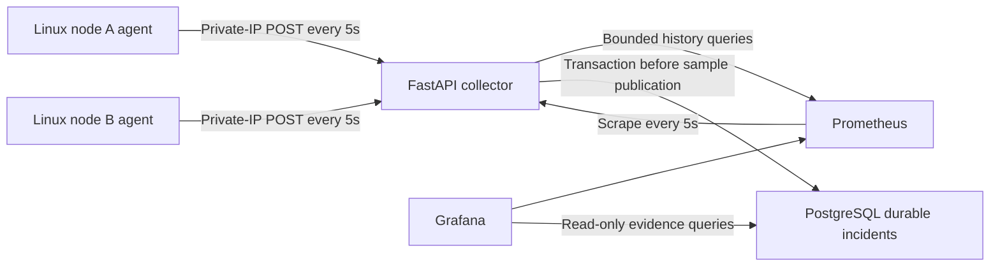

# FleetDoctor

FleetDoctor monitors a small Linux fleet and produces evidence-supported disk diagnoses. **Tasks 01 and 02 implement filesystem collection, healthy-fleet visibility and durable disk incident lifecycle.** Task02 passed local checks and two AWS functional lifecycles on 2026-10-11; see [Task02 evidence](docs/task02-evidence.md) for the frozen inspection record and verification limits. Outage queues and durable ingestion follow in tasks 03 and 04. The [PRD](<FleetDoctor PRD.md>) owns the full project's requirements.



Implementation began **2026-10-11**, with a two-week target ending **2026-10-25**. Project CI and live completion are separate gates. See [task01 evidence](docs/task01-evidence.md), [AWS operations](docs/aws-lab.md), [cost estimate](docs/costs.md), and [metric semantics](docs/metrics.md).

## Local setup

Install Python 3.11+, uv and Docker with a Linux engine. From this checkout:

```text
uv sync --locked --all-extras
uv run python scripts/create_env.py .env
# For a retained env: uv run python scripts/upgrade_env.py <retained-env> --disk
docker compose up -d --build --wait
uv run python scripts/integration.py --output <external-path>/integration.json
```

The ordinary stack has no synthetic agents. Host agents are installed on Linux through [the AWS runbook](docs/aws-lab.md). The integration command creates a separate unique project and secrets, sends fixture samples for two nodes, checks API/history/dashboard/persistent stores and Linux statvfs, then removes **only its own** containers/volumes. Its evidence is explicitly a synthetic service test.

Open Grafana at http://127.0.0.1:3000, user `admin`, password from your untracked `.env`. Dashboard folder **FleetDoctor** contains **Fleet** and **Node**, refreshed every five seconds. Bytes and ratios have explicit panel units; select a node on the Node dashboard. Query `/nodes`, `/nodes/node-a/metrics`, `/metrics`, and `/health` at http://127.0.0.1:8000. Supplying `start`, `end`, `step` and optional `field` to a node metric endpoint returns Prometheus history. Times must include a timezone, the range must be ordered/past and no longer than seven days, steps 5–86400 seconds and at most 1500 points per series. Supported fields: `available_bytes`, `used_bytes`, `block_usage_ratio`. No arbitrary PromQL.

`docker compose down` preserves named data volumes. `down --volumes` removes them; export before lab teardown. Every service rotates Docker logs at 10MiB × 3 files. Prometheus retention is seven days and 2GB. PostgreSQL and Grafana keep their persistent volumes without a claimed hard quota; monitor host disk space. The collector has one worker and bounded memory for the latest sample per registered node. PostgreSQL persists incidents; ingestion checkpoints arrive in task 04. Required storage failure returns 503 without advancing eligible samples or diagnosis windows. Ingest acknowledgments distinguish `incidents_durable: true` and `durable: false` for samples. `/nodes` reports active counts and per-filesystem disk coverage; unavailable storage cannot fabricate zero counts. Eligible transactions reconcile committed incidents before evaluation, so a lost COMMIT acknowledgement can be retried without stranding a second incident or changing the original resolution.

## Verification

```text
uv sync --locked --all-extras
uv run ruff format --check .
uv run ruff check .
uv run mypy src tests scripts
uv run pytest
uv run python -c "import fleetdoctor.agent, fleetdoctor.collector"
terraform -chdir=infra/aws fmt -check
terraform -chdir=infra/aws init -backend=false -lockfile=readonly
terraform -chdir=infra/aws validate
uv run python scripts/integration.py --output <external-path>/integration.json
```

Static checking targets Linux. Fixture tests also run on Windows; the isolated Docker check exercises actual Linux statvfs. CI requires no AWS credentials or live model calls. The Task01/02 workflow covers delivered behavior; it does not claim the full future CI gate or the one-hour healthy baseline/agent overhead checks from task 16. The seven remaining diagnosis types, calibrated scenario batches, postmortem drafting and workload traces remain later tickets.

## Disk diagnosis

See the [bounded disk runbook](docs/disk-full.md), [measurement schema](docs/chaos-measurements.md), and [Task02 evidence status](docs/task02-evidence.md). `/diagnoses` returns summaries with `node`, `rule`, `status`, timezone-aware opening-time `start`/`end`, `limit` (1..100) and `offset` (0..10000), total/next-offset metadata and stable descending opening-time/UUID order. `/diagnoses/{uuid}` provides immutable opening evidence, latest evidence/configuration/steps and lifecycle timestamps; unknown IDs return 404. `/configuration` exposes effective disk settings and filesystem paths.

Grafana Fleet/Node dashboards contain disk lifecycle and readable evidence tables with active/resolved filters. A SELECT-only PostgreSQL reader uses a separate private password; provisioning works on retained volumes. Observation age and a persisted reload flag determine stale evidence. Missing block counters are unavailable independently of fresh delivery. After collector restart active incidents remain visible but stale until new eligible evidence arrives; pending windows are rebuilt. This does not establish restart ingest idempotency (Task04).
