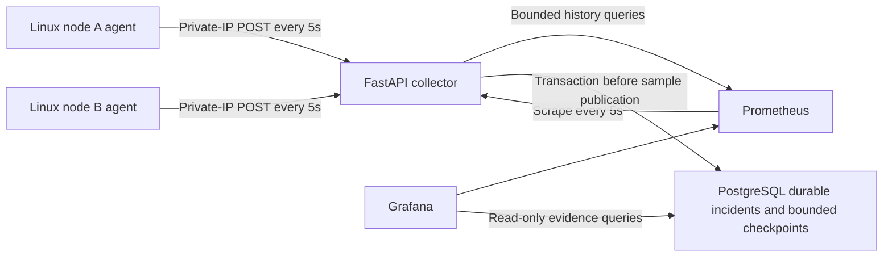

# FleetDoctor

FleetDoctor monitors a small Linux fleet and produces evidence-supported resource diagnoses. **Tasks 01 and 02 implement filesystem collection, healthy-fleet visibility and durable disk incident lifecycle.** Task02 passed local checks and two AWS functional lifecycles on 2026-10-11; see [Task02 evidence](docs/task02-evidence.md) for the frozen inspection record and verification limits. Task03 adds bounded outage delivery and reporting. Task04 adds durable bounded ingestion checkpoints and restart recovery; [Task04 evidence](docs/task04-evidence.md) separates builder proof from independent and live gates. Task05 adds strict v2 host CPU telemetry and the CPU saturation lifecycle; see the [CPU runbook](docs/cpu-saturation.md) and [Task05 evidence status](docs/task05-evidence.md). The [PRD](<FleetDoctor PRD.md>) owns the full project's requirements.



Implementation began **2026-10-11**, with a two-week target ending **2026-10-25**. Project CI and live completion are separate gates. See [task01 evidence](docs/task01-evidence.md), [AWS operations](docs/aws-lab.md), [cost estimate](docs/costs.md), and [metric semantics](docs/metrics.md).

## Local setup

Install Python 3.11+, uv and Docker with a Linux engine. From this checkout:

```text
uv sync --locked --all-extras
uv run python scripts/create_env.py .env
# For a retained env: uv run python scripts/upgrade_env.py <retained-env> --disk
docker compose up -d --build --wait
uv run python scripts/integration.py --output <external-path>/integration.json
uv run python scripts/disk_helper_integration.py --output <external-path>/disk-helper.json
# Native Linux/WSL only; deliberately limited and not a saturation claim:
uv run python scripts/cpu_smoke.py --workers 2 --seconds 5 --output <external-path>/cpu-smoke.json
```

The ordinary stack has no synthetic agents. Host agents are installed on Linux through [the AWS runbook](docs/aws-lab.md). The integration command creates a separate unique project and secrets, sends fixture samples for two nodes, checks atomic PostgreSQL checkpoints, collector restart, API/history/dashboard/persistent stores and Linux statvfs, then removes **only its own** containers/volumes. Its evidence is explicitly a synthetic service test. The same command also runs a 25-second node-a-only outage through production agent transport, with node-b continuity and real Prometheus gap assertions.

Open Grafana at http://127.0.0.1:3000, user `admin`, password from your untracked `.env`. Dashboard folder **FleetDoctor** contains **Fleet** and **Node**, refreshed every five seconds. Bytes and ratios have explicit panel units; select a node on the Node dashboard. Query `/nodes`, `/nodes/node-a/metrics`, `/metrics`, and `/health` at http://127.0.0.1:8000. Supplying `start`, `end`, `step` and optional `field` to a node metric endpoint returns Prometheus history. Times must include a timezone, the range must be ordered/past and no longer than seven days, steps 5–86400 seconds and at most 1500 points per series. Supported fields include the fixed filesystem fields plus `cpu_busy_ratio`, `cpu_iowait_ratio`, `cpu_steal_ratio`, `cpu_logical_cores`, `cpu_runnable_processes`, `cpu_load_1m`, `cpu_load_5m`, `cpu_load_15m`, and `cpu_coverage_ratio`. No arbitrary PromQL.

`docker compose down` preserves named data volumes. `down --volumes` removes them; export before lab teardown. Every service rotates Docker logs at 10MiB × 3 files. Prometheus retention is seven days and 2GB. PostgreSQL and Grafana keep their persistent volumes without a claimed hard quota; monitor host disk space. The collector has one worker and bounded memory for registered nodes. PostgreSQL persists incidents and one bounded ingestion checkpoint per node. The request cap remains 65,536 bytes; its checkpoint has a separate 131,072-byte cap for the typed latest sample plus 60 fingerprints and eight retired sessions. Each successful eligible ingest atomically commits incident changes and its checkpoint before memory publication. Required incident or checkpoint storage failure returns 503 without advancing eligible samples or diagnosis windows. Updated agents negotiate `checkpoints-v1`; legacy acknowledgement shape remains supported. `checkpoint_durable:true` covers accepted or retained identical committed identities, while `durable:false` still states that complete sample history is not stored. After restart, stored ordering/age metadata reloads without making restored resource or delivery gauges live, and pending windows rebuild only from new eligible observations.

## Verification

```text
uv sync --locked --all-extras
uv run ruff format --check .
uv run ruff check .
uv run mypy src tests scripts
uv run pytest
uv run python -c "import fleetdoctor.agent, fleetdoctor.collector"
terraform -chdir=infra/aws fmt -check
terraform -chdir=infra/aws init -backend=false -lockfile=readonly
terraform -chdir=infra/aws validate
uv run python scripts/integration.py --output <external-path>/integration.json
uv run python scripts/disk_helper_integration.py --output <external-path>/disk-helper.json
```

Static checking targets Linux. Fixture tests also run on Windows; the isolated Docker check exercises actual Linux statvfs. CI requires no AWS credentials or live model calls. The Task01 through Task05 workflow covers delivered behavior; it does not claim remote CI, rendered dashboard inspection, AWS CPU saturation, the full future CI gate, or the one-hour healthy baseline/agent overhead checks from task 16. The six remaining diagnosis types, calibrated scenario batches, postmortem drafting and workload traces remain later tickets.

## CPU saturation diagnosis

New agents send schema v2 while the collector continues to accept historical schema v1 samples. Deploy the collector before the v2 agent. CPU busy, iowait, steal, runnable demand, online logical cores, separate load averages, raw counters, and bounded process observations come from `/proc`; unavailable or reset rate intervals remain null. Three eligible samples with busy CPU at least 90% and runnable demand greater than cores open `cpu_saturation` for resource `cpu`. Three fresh samples below 80% busy resolve it. Load, iowait, and steal are context rather than substitute triggers. Process rows are bounded structured evidence without Prometheus PID/command labels and never claim a sole culprit.

The Fleet and Node dashboards expose fresh CPU ratios, demand versus cores, load/steal context, coverage, and a shared CPU/disk incident feed. See [docs/cpu-saturation.md](docs/cpu-saturation.md) before any workload run. The local smoke is capped at two workers for five seconds and demonstrates collection plus owned cleanup only; it does not seek or prove host saturation.

## Disk diagnosis

See the [bounded disk runbook](docs/disk-full.md), [measurement schema](docs/chaos-measurements.md), and [Task02 evidence status](docs/task02-evidence.md). `/diagnoses` returns summaries with `node`, `rule`, `status`, timezone-aware opening-time `start`/`end`, `limit` (1..100) and `offset` (0..10000), total/next-offset metadata and stable descending opening-time/UUID order. `/diagnoses/{uuid}` provides immutable opening evidence, latest evidence/configuration/steps and lifecycle timestamps; unknown IDs return 404. `/configuration` exposes effective disk settings and filesystem paths.

Grafana Fleet/Node dashboards contain disk lifecycle and readable evidence tables with active/resolved filters. A SELECT-only PostgreSQL reader uses a separate private password; provisioning works on retained volumes. Observation age and a persisted reload flag determine stale evidence. Missing block counters are unavailable independently of fresh delivery. After collector restart active incidents remain visible but stale until new eligible evidence arrives; pending windows and counter baselines rebuild from fresh observations. Retained committed identities remain duplicate across restart without republishing restored gauges.

## Outage delivery

See [outage and replay handling](docs/outage-and-replay.md) for exact queue bounds, retry/acknowledgement behavior, compatibility, session discard semantics and the prepared unrun lab procedure. Latest reporting is unavailable for old agents; a reported discard gauge is scoped to the current session and must be read with observation age/stale. Collector incident changes and bounded ordering checkpoints are durable and atomic. Agent queues remain process-local and complete sample history is not persisted.
